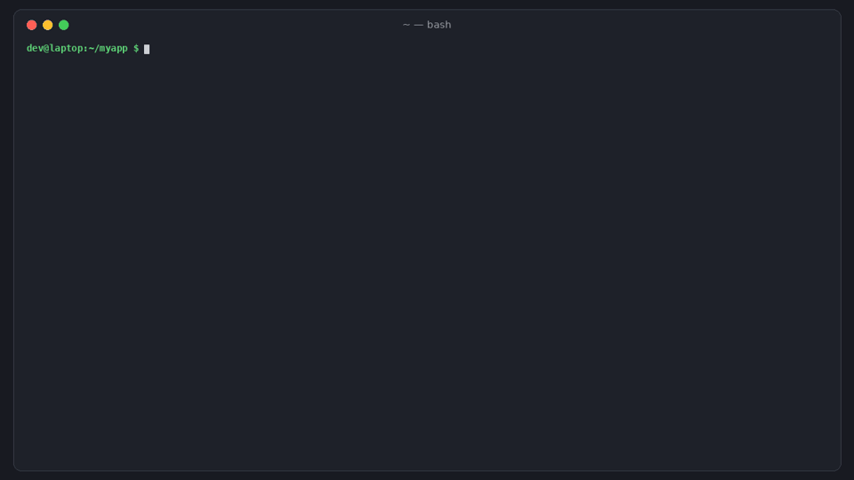

# ghseal

[](https://github.com/hamarshehmhmd/ghseal/actions/workflows/ci.yml)
[](LICENSE)


**Stop sending `.env` files over Slack.** ghseal encrypts your `.env` to your teammates' GitHub SSH keys
(the ones already at `github.com/<user>.keys`), so you can commit the encrypted file next to your code.
Run your app with the secrets injected and no plaintext file on disk, which also means no `.env` for an AI coding agent to read.



```sh
curl -fsSL https://raw.githubusercontent.com/hamarshehmhmd/ghseal/main/install.sh | sh
```

## The problem

Small teams still share secrets by pasting `.env` files into Slack, DMs and password-manager notes
([Ask HN: How do you share .env files with your team?](https://news.ycombinator.com/item?id=41481482),
[79 comments on managing env secrets](https://news.ycombinator.com/item?id=41629168)). Those files drift between
laptops, nobody knows who still has the production Stripe key after someone leaves, and coding agents read whatever is
in the workspace ([Cursor uploads .env file with secrets despite .gitignore](https://news.ycombinator.com/item?id=43331770)).
Vault, Doppler and Infisical fix this, but they mean a server, accounts and a bill. That's a lot for a 4-person team.

## What ghseal does

- **Uses the keys your team already has.** `ghseal add @alice` fetches Alice's public SSH keys from GitHub (or
  `gitlab:` / `codeberg:`), pins them in `.ghseal.json`, and encrypts to them. No server, no accounts, no key exchange.
- **Commits ciphertext, not secrets.** `.env.sealed` is a standard [age](https://age-encryption.org) file (ASCII armored).
  If ghseal ever disappears, `age -d -i ~/.ssh/id_ed25519 .env.sealed` still opens it.
- **`ghseal run -- npm start`** decrypts in memory and injects the variables. There's no plaintext `.env` on disk for
  an agent, a backup tool or a screen share to pick up.
- **Edit without decrypting to disk:** `ghseal set KEY=value`, `ghseal unset KEY`, `ghseal get KEY`, `ghseal names`.
- **Offboarding that tells the truth:** `ghseal remove bob` re-seals the file without Bob's keys, then lists every
  secret he could read, because he can still decrypt old versions from git history. Rotate those.
- **Key-change detection:** `ghseal refresh` re-fetches everyone's GitHub keys and fails if they changed (new laptop,
  or a hijacked account) until you confirm with `--accept`.
- **CI / pre-commit gate:** `ghseal check` fails if the sealed file is missing someone listed in `.ghseal.json`, is still
  readable by a key that was removed, or if a plaintext `.env` got committed. It warns about unsealed local edits.
- **AI agent ignore rules:** `ghseal init` / `ghseal guard` add your env files to `.cursorignore`, `.aiexclude`
  (Gemini), `.codeiumignore` (Windsurf), `.aiderignore` and Claude Code `permissions.deny` (`Read(./.env)`).
  These are best effort, since an agent with a shell can still `cat` a file. `ghseal run` is the stronger fix.
- **CI machines get an age key:** `ghseal keygen` makes an `age1…` key. Add the public half as a recipient and store the
  secret as a `GHSEAL_AGE_KEY` repository secret.

## Install

One line (uses `uv tool`, then `pipx`, then a private venv in `~/.local/share/ghseal`):

```sh
curl -fsSL https://raw.githubusercontent.com/hamarshehmhmd/ghseal/main/install.sh | sh
```

Or with pip / pipx / uv:

```sh
pipx install git+https://github.com/hamarshehmhmd/ghseal
uv tool install git+https://github.com/hamarshehmhmd/ghseal
```

Needs Python 3.10+. Dependencies: [pyrage](https://github.com/woodruffw/pyrage) (Rust `age` bindings),
`cryptography` + `bcrypt` (for passphrase-protected SSH keys). Linux, macOS and Windows are tested in CI.

## Usage

```sh
cd myapp
ghseal init                      # .ghseal.json, gitignore /.env, AI agent ignore rules
ghseal add @your-github-username # yourself first
ghseal add @alice @bob           # teammates' GitHub keys (ssh-ed25519 / ssh-rsa)
ghseal seal                      # .env -> .env.sealed
git add .ghseal.json .env.sealed .gitignore .cursorignore .claude/settings.json && git commit -m "sealed env"
```

A teammate pulls and runs:

```sh
ghseal run -- npm run dev        # secrets injected, nothing written
ghseal open                      # or write .env (mode 600) if a tool insists on the file
```

Day to day:

```sh
ghseal set STRIPE_SECRET_KEY     # prompts (or reads stdin), re-seals, no shell history
ghseal diff                      # local .env vs sealed: + added, - removed, ~ changed (names only)
ghseal seal                      # no-op if nothing changed, so git diffs stay quiet
ghseal ls                        # recipients and pinned key fingerprints
ghseal remove bob                # re-seal without bob + list secrets to rotate
ghseal refresh                   # did anyone's GitHub keys change?
ghseal track .env.production     # more files; `ghseal run -f .env.production -- ...`
```

Which private key decrypts? In order: `-i FILE` (repeatable), `$GHSEAL_IDENTITY`, `$GHSEAL_AGE_KEY`, then
`~/.ssh/id_ed25519`, `~/.ssh/id_rsa`, `~/.config/ghseal/keys.txt`. Passphrase-protected SSH keys prompt, or read
`$GHSEAL_PASSPHRASE`.

### In CI (GitHub Actions)

```sh
ghseal keygen -o ci.key          # prints age1... ; keep ci.key out of git
ghseal add age1... --name github-actions && ghseal seal
# store the AGE-SECRET-KEY-... line from ci.key as the repository secret GHSEAL_AGE_KEY, then delete ci.key
```

```yaml
- run: pipx install git+https://github.com/hamarshehmhmd/ghseal
- run: ghseal check --strict
- run: ghseal run -- npm test
  env:
    GHSEAL_AGE_KEY: ${{ secrets.GHSEAL_AGE_KEY }}
```

### Pre-commit

```yaml
- repo: local
  hooks:
    - id: ghseal-check
      name: ghseal check
      entry: ghseal check
      language: system
      pass_filenames: false
```

## Demo

The GIF above is a real run. The full narrated walkthrough (about 2.5 minutes) is attached to the
[v0.1.0 release](https://github.com/hamarshehmhmd/ghseal/releases/tag/v0.1.0) as `demo.mp4`, and `demo/render.py` regenerates it.

## How it works and its limits

- `.env.sealed` is age v1 with one stanza per recipient key. `ghseal check` reads the stanza tags in the header
  (SHA-256 of each SSH key, first 4 bytes) to prove who can open the file without decrypting it. age X25519 stanzas
  don't identify their recipient, so for `age1` keys it only checks the count.
- age supports `ssh-ed25519` and `ssh-rsa` keys. ECDSA and hardware (FIDO, `sk-`) SSH keys are skipped with a warning;
  give those people an `age1` key instead.
- Removing someone does not un-share anything they already decrypted, and they can still open old commits.
  That's why `remove` prints a rotation list. Rotating the actual secrets is up to you.
- Pinning is trust-on-first-use: the first `ghseal add @user` trusts whatever GitHub serves. Check fingerprints
  (`ghseal ls`) with the person once.
- Whole-file encryption: a changed value re-encrypts the file, so you see *that* it changed in git, not *which* key
  (use `ghseal diff`). ghseal skips re-encrypting when nothing changed.
- No variable expansion (`${OTHER}`) and no secret-scanning of your codebase. It does one job.

## Development

```sh
python -m venv .venv && . .venv/bin/activate
pip install -e . pytest
pytest -q                      # GHSEAL_LIVE=1 also fetches real keys from github.com; installs `age` to run interop tests
python demo/render.py --gif    # regenerate docs/demo.gif (and without --gif, demo.mp4)
```

## License

ghseal is licensed under the **GNU Affero General Public License v3.0 or later** (`AGPL-3.0-or-later`); see [LICENSE](LICENSE).
**Commercial licenses** without the AGPL obligations (for embedding ghseal in a closed-source product or service)
are available from the author, [Mohammad Hamarsheh](https://github.com/hamarshehmhmd). Open an issue or get in touch via GitHub.
